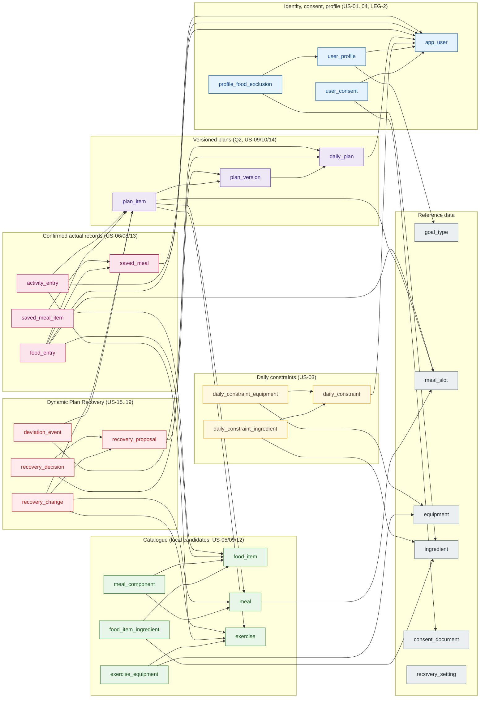
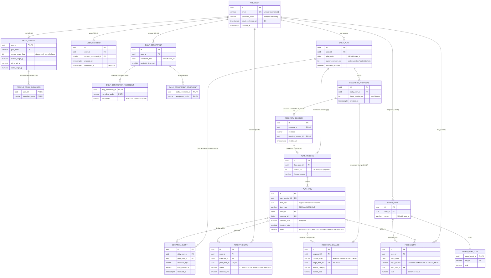
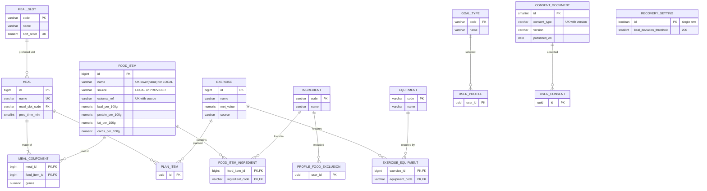

# VEYA logical database diagram

Logical model of schema `veya` (PostgreSQL 17, Flyway V1–V10). It refines the BA data model
(Fig. B.11) with the entities required by the Must stories and the agreed decisions Q2–Q7
(see [`../ba-open-questions.md`](../ba-open-questions.md)). Every attribute is described in the
[data dictionary](data-dictionary.md). The diagrams render on GitHub (Mermaid).

Notation: `||--o{` one-to-many, `||--o|` one-to-zero-or-one, `}o--||` many-to-one;
PK primary key, FK foreign key, UK unique. Relationship types used: one-to-one (`app_user`–`user_profile`),
one-to-zero-or-one (`recovery_proposal`–`recovery_decision`), one-to-many (most), many-to-many through
junction tables (`meal_component`, `food_item_ingredient`, `exercise_equipment`, `profile_food_exclusion`,
`daily_constraint_ingredient`, `daily_constraint_equipment`).

## 0. Main blocks (colour-coded overview)

Each box is a table; arrows point from the referencing table to the referenced one (foreign key).

## 1. Users, plans, actual records and recovery

## 2. Catalogue and reference data

## Mapping to the BA data model (Fig. B.11)

| Fig. B.11 entity | Schema | Change and reason |
|---|---|---|
| User | `app_user` | + `adult_confirmed_at` (Q8), `updated_at` |
| Profile (goal, energy_target, preferences) | `user_profile`, `profile_food_exclusion` | "preferences" = permanent exclusions (Q5), stored as a relation (1NF); macro targets added for US-07 (Q3) |
| PlanningConstraint (date, available_time, equipment, excluded_foods) | `daily_constraint` + `daily_constraint_ingredient` + `daily_constraint_equipment` | multi-valued attributes moved to relations (1NF); available ingredients added (Q3) |
| DailyPlan (date, status, version) | `daily_plan` + `plan_version` | immutable versions (Q2); `status` is the derived `recovery_required` flag + active version |
| PlanItem | `plan_item` | `item_key`, meal/exercise FKs and macros added (Q3) |
| FoodEntry, ActivityEntry | `food_entry`, `activity_entry` | `input_source`, saved-meal link (US-08) |
| RecoveryProposal (status) | `recovery_proposal` | `status` not stored - derived in `v_recovery_proposal_overview` (avoids redundancy) |
| RecoveryChange (old_value, new_value, reason) | `recovery_change` | old value = FK `target_item_id`; new value = typed columns; reason category + text (US-17) |
| RecoveryDecision | `recovery_decision` | + `resulting_version_id` (link to the version created) |
| — | `deviation_event` | trigger of `recoveryRequired` (Q4, US-15) |
| — | `saved_meal`, `saved_meal_item` | US-08 (Q4) |
| — | `food_item`, `meal`, `meal_component`, `exercise`, … | local candidate catalogue (Q4, US-31, NFR-02) |
| — | `user_consent`, `consent_document` | LEG-2 (Q7) |
